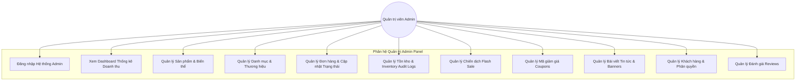
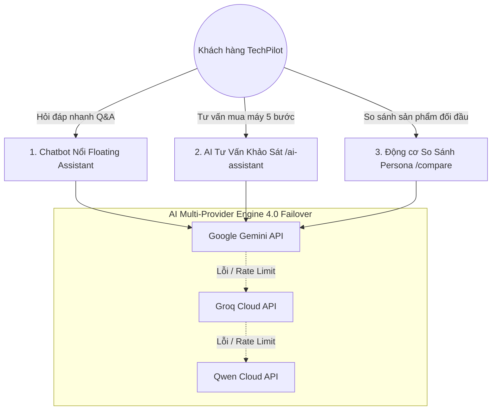
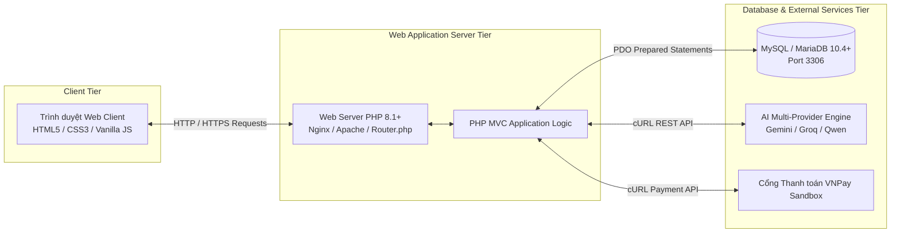

# TRƯỜNG CAO ĐẲNG FPT POLYTECHNIC
## BÁO CÁO DỰ ÁN 1

### DỰ ÁN: XÂY DỰNG HỆ THỐNG THƯƠNG MẠI ĐIỆN TỬ CÔNG NGHỆ & TRỢ LÝ AI 4.0 — TECHPILOT

- **Website Client:** [https://polysmart.me](https://polysmart.me) *(Domain thử nghiệm hệ thống)*
- **Website Admin:** [https://polysmart.me/admin](https://polysmart.me/admin)
- **Repository GitHub:** [https://github.com/ntrungz0704/TechPilot](https://github.com/ntrungz0704/TechPilot)
- **Giảng viên hướng dẫn:** Thầy Lê Phát Hiện

**Sinh viên thực hiện:**
1. Nguyễn Phạm Thành Trung — PS47261 *(Trưởng nhóm / Lead Backend & AI Engine)*
2. Nguyễn Minh Hiếu — PS47378 *(Lead Frontend Client UI/UX)*
3. Bàn Tiến Kim — PS47376 *(Lead Admin Panel & Database)*
4. Trần Ngọc Xuân Đình — PS47346 *(Lead QC / Tester & Technical Documentation)*

*TP. Hồ Chí Minh, ngày 02 tháng 08 năm 2026*

---

## NHẬN XÉT CỦA GIẢNG VIÊN

### Giảng viên 1:
...................................................................................................................................................................................
...................................................................................................................................................................................
...................................................................................................................................................................................
...................................................................................................................................................................................

### Giảng viên 2:
...................................................................................................................................................................................
...................................................................................................................................................................................
...................................................................................................................................................................................
...................................................................................................................................................................................

---

## MỤC LỤC

- [CHƯƠNG 1: GIỚI THIỆU DỰ ÁN](#chương-1-giới-thiệu-dự-án)
  - [1.1 Tổng quan & Mục tiêu dự án](#11-tổng-quan--mục-tiêu-dự-án)
  - [1.2 Khảo sát các website thương mại điện tử tương tự](#12-khảo-sát-các-website-thương-mại-điện-tử-tương-tự)
    - [1.2.1 Website GEARVN](#121-website-gearvn)
    - [1.2.2 Website Phong Vũ](#122-website-phong-vũ)
  - [1.3 Giải pháp CNTT của TechPilot](#13-giải-pháp-cntt-của-techpilot)
  - [1.4 Kế hoạch thực hiện dự án](#14-kế-hoạch-thực-hiện-dự-án)
  - [1.5 Bảng phân công công việc chi tiết](#15-bảng-phân-công-công-việc-chi-tiết)
- [CHƯƠNG 2: PHÂN TÍCH HỆ THỐNG](#chương-2-phân-tích-hệ-thống)
  - [2.1 Sơ đồ Use Case tổng quan](#21-sơ-đồ-use-case-tổng-quan)
    - [2.1.1 Phân hệ Khách hàng (User Client)](#211-phân-hệ-khách-hàng-user-client)
    - [2.1.2 Phân hệ Quản trị (Admin Panel)](#212-phân-hệ-quản-trị-admin-panel)
  - [2.2 Đặc tả yêu cầu phần mềm (SRS)](#22-đặc-tả-yêu-cầu-phần-mềm-srs)
    - [2.2.1 Chức năng phân hệ Quản trị (Admin Panel)](#221-chức-năng-phân-hệ-quản-trị-admin-panel)
    - [2.2.2 Chức năng phân hệ Khách hàng (User Client)](#222-chức-năng-phân-hệ-khách-hàng-user-client)
    - [2.2.3 Hệ thống 3 chức năng AI độc lập (Decoupled AI Engine)](#223-hệ-thống-3-chức-năng-ai-độc-lập-decoupled-ai-engine)
    - [2.2.4 Yêu cầu an toàn & Bảo mật hệ thống](#224-yêu-cầu-an-toàn--bảo-mật-hệ-thống)
  - [2.3 Mô hình triển khai & Yêu cầu kỹ thuật](#23-mô-hình-triển-khai--yêu-cầu-kỹ-thuật)
- [CHƯƠNG 3: THIẾT KẾ ỨNG DỤNG](#chương-3-thiết-kế-ứng-dụng)
  - [3.1 Kiến trúc công nghệ của ứng dụng (PHP MVC Monolith)](#31-kiến-trúc-công-nghệ-của-ứng-dụng-php-mvc-monolith)
  - [3.2 Mô hình cơ sở dữ liệu quan hệ ERD](#32-mô-hình-cơ-sở-dữ-liệu-quan-hệ-erd)
  - [3.3 Chi tiết các thực thể dữ liệu (28 Bảng vật lý)](#33-chi-tiết-các-thực-thể-dữ-liệu-28-bảng-vật-lý)
  - [3.4 Thiết kế giao diện & Sơ đồ tổ chức UI](#34-thiết-kế-giao-diện--sơ-đồ-tổ-chức-ui)
- [CHƯƠNG 4: THỰC HIỆN DỰ ÁN](#chương-4-thực-hiện-dự-án)
  - [4.1 Tổ chức cấu trúc mã nguồn dự án (PHP MVC Architecture)](#41-tổ-chức-cấu-trúc-mã-nguồn-dự-án-php-mvc-architecture)
  - [4.2 Thực hiện giao diện & Logic xử lý Phân hệ Khách hàng](#42-thực-hiện-giao-diện--logic-xử-lý-phân-hệ-khách-hàng)
  - [4.3 Thực hiện giao diện & Logic xử lý Phân hệ Quản trị](#43-thực-hiện-giao-diện--logic-xử-lý-phân-hệ-quản-trị)
- [CHƯƠNG 5: KIỂM THỬ HỆ THỐNG (TESTING)](#chương-5-kiểm-thử-hệ-thống-testing)
  - [5.1 Đăng nhập & Đăng ký người dùng](#51-đăng-nhập--đăng-ký-người-dùng)
  - [5.2 Đổi mật khẩu & Quên mật khẩu](#52-đổi-mật-khẩu--quên-mật-khẩu)
  - [5.3 Tìm kiếm & Lọc sản phẩm](#53-tìm-kiếm--lọc-sản-phẩm)
  - [5.4 Chức năng Flash Sale](#54-chức-năng-flash-sale)
  - [5.5 Giỏ hàng & Thanh toán (COD & VNPay Sandbox)](#55-giỏ-hàng--thanh-toán-cod--vnpay-sandbox)
  - [5.6 Quản lý Sản phẩm, Danh mục, Đơn hàng (Admin)](#56-quản-lý-sản-phẩm-danh-mục-đơn-hàng-admin)
- [CHƯƠNG 6: ĐÓNG GÓI VÀ TRIỂN KHAI](#chương-6-đóng-gói-và-triển-khai)
  - [6.1 Đóng gói sản phẩm & Thông tin truy cập](#61-đóng-gói-sản-phẩm--thông-tin-truy-cập)
  - [6.2 Triển khai Website lên môi trường Production](#62-triển-khai-website-lên-môi-trường-production)
  - [6.3 Kết luận & Hướng phát triển dự án](#63-kết-luận--hướng-phát-triển-dự-án)

---

## CHƯƠNG 1: GIỚI THIỆU DỰ ÁN

### 1.1 Tổng quan & Mục tiêu dự án

- **Tên dự án:** TechPilot – Hệ thống thương mại điện tử công nghệ & Trợ lý AI 4.0.
- **Mục tiêu dự án:** 
  1. Áp dụng toàn bộ kiến thức về phân tích thiết kế hệ thống và lập trình ứng dụng web để hoàn thiện một nền tảng thương mại điện tử quy mô thương mại.
  2. Xây dựng ứng dụng dựa trên nền tảng **PHP MVC thuần** (không sử dụng framework nặng), kết hợp với **MySQL/MariaDB**, **HTML5**, **Vanilla CSS** và **JavaScript (ES6+)**.
  3. Tích hợp giải pháp Trí tuệ Nhân tạo đa nhà cung cấp (**AI Multi-Provider Engine 4.0** bao gồm Google Gemini, Groq Cloud, Qwen Cloud) vào luồng trải nghiệm mua sắm thiết bị công nghệ (Laptop, PC lắp sẵn, Linh kiện, Màn hình & Gaming Gear).

Trong bối cảnh thị trường phần cứng máy tính và thiết bị công nghệ phát triển bùng nổ, việc chọn mua một mẫu Laptop, dàn PC Gaming hay linh kiện phù hợp ngày càng trở nên phức tạp. Người tiêu dùng phổ thông thường bị "bội thực thông tin" bởi vô số thông số kỹ thuật (DPI, Polling Rate, Refresh Rate, Socket, PSU Headroom, VRAM...). Người mua thường mất nhiều ngày tìm kiếm, đọc bài đánh giá và tự so sánh nhưng vẫn nguy cơ chọn sai sản phẩm không tương thích.

**TechPilot** ra đời nhằm giải quyết triệt để thách thức trên. Không chỉ dừng lại là một website bán lẻ công nghệ trực tuyến với catalog **650+ sản phẩm thực tế**, TechPilot đóng vai trò như một **Trợ lý mua sắm AI thông minh**, cá nhân hóa trải nghiệm và tư vấn chính xác theo nhu cầu thực tế lẫn ngân sách của người dùng.

---

### 1.2 Khảo sát các website thương mại điện tử tương tự

#### 1.2.1 Website GEARVN

- **Các chức năng đang có:**
  - Danh mục sản phẩm phong phú: PC Gaming, Laptop, Màn hình, Chuột, Bàn phím cơ, Tai nghe, Linh kiện máy tính, Ghế gaming, Phụ kiện công nghệ.
  - Trang chi tiết sản phẩm: Hình ảnh đa góc độ, Giá bán, Thông số kỹ thuật chi tiết, Mô tả khuyến mãi, Tình trạng tồn kho, Đánh giá của khách hàng, Sản phẩm liên quan.
  - Giỏ hàng và thanh toán: Thêm vào giỏ hàng, Mua ngay, Thanh toán COD, Chuyển khoản, Trả góp qua thẻ.
  - Quản lý tài khoản: Đăng ký, Đăng nhập, Quản lý địa chỉ giao hàng, Theo dõi trạng thái đơn hàng.
  - Tin tức công nghệ: Bài viết review, tư vấn build PC, hướng dẫn thủ thuật.

- **Đánh giá Điểm mạnh & Điểm yếu:**
  - **Điểm mạnh:** Danh mục hàng hóa phong phú; Bộ lọc sản phẩm theo thương hiệu và phân khúc giá tốt; Thương hiệu bán lẻ uy tín.
  - **Điểm yếu:** 
    - Giao diện nhiều thông tin mật độ cao, gây ngợp đối với khách hàng mới.
    - Thiếu công cụ AI giải thích các khái niệm kỹ thuật phức tạp theo ngôn ngữ dễ hiểu.
    - Chưa có tính năng tư vấn động theo khảo sát nhu cầu/ngân sách dạng AI Interactive.
    - Đề xuất sản phẩm còn thụ động (chỉ dựa trên cùng danh mục).

#### 1.2.2 Website Phong Vũ

- **Các chức năng đang có:**
  - Cung cấp đa dạng ngành hàng: Laptop, PC, Linh kiện máy tính, Thiết bị văn phòng, Gaming gear, Sản phẩm Apple chính hãng.
  - Bộ lọc tìm kiếm: Tìm theo tên, thương hiệu, giá bán, cấu hình chi tiết.
  - Tính năng Build PC: Cho phép khách hàng tự chọn từng linh kiện cấu hình máy.
  - Phương thức thanh toán & Giao hàng: Giao hàng tận nhà, nhận tại showroom, thanh toán online (VNPAY/Momo).

- **Đánh giá Điểm mạnh & Điểm yếu:**
  - **Điểm mạnh:** Hệ thống showroom rộng khắp; Công cụ Build PC cơ bản hoạt động ổn định; Thanh toán linh hoạt.
  - **Điểm yếu:**
    - Giao diện trải nghiệm người dùng (UX) chưa thực sự mượt mà trên mobile.
    - Công cụ Build PC chưa tự động kiểm tra và tính toán tổng công suất nguồn tiêu thụ (PSU Headroom) để cảnh báo thiếu nguồn.
    - Thiếu tính năng AI so sánh sản phẩm đối đầu chuyên sâu theo Persona (User Profile).

---

### 1.3 Giải pháp CNTT của TechPilot

Dựa trên việc phân tích các hạn chế của các hệ thống hiện hữu, dự án **TechPilot** mang đến các giải pháp công nghệ vượt trội:

1. **Nền tảng Ecommerce PHP MVC Thuần chuẩn hóa:** Tối ưu hóa hiệu năng máy chủ, thời gian phản hồi dưới 1.5 giây, đảm bảo khả năng mở rộng mượt mà.
2. **Hệ thống AI Multi-Provider Engine 4.0 (Failover 3 cấp):**
   - Tự động luân chuyển linh hoạt giữa 3 nhà cung cấp AI: **Google Gemini API** $\rightarrow$ **Groq Cloud API** $\rightarrow$ **Qwen Cloud API**. Đảm bảo trợ lý AI luôn sẵn sàng 24/7 ngay cả khi một nhà cung cấp gặp sự cố hoặc vượt giới hạn rate-limit.
3. **Bộ 3 Công cụ AI Độc lập (Decoupled AI Architecture):**
   - **Chatbot Nổi Q&A (Floating Assistant):** Giải đáp thắc mắc trực tiếp 24/7, tư vấn chính sách và giải thích thuật ngữ phần cứng.
   - **AI Tư Vấn Khảo Sát 5 Bước (`/ai-assistant`):** Thuật toán chấm điểm định hướng (Deterministic 100-Point Scoring) tự động đề xuất 3 sản phẩm tối ưu: `PHÙ HỢP NHẤT`, `ĐÁNG TIỀN NHẤT`, `HIỆU NĂNG CAO NHẤT`.
   - **Động cơ So sánh Chuyên sâu theo Persona (`/compare`):** Khóa danh mục cứng (Category-First Workflow), phân tích ma trận thông số kỹ thuật và cảnh báo vi phạm yêu cầu cứng (`NOT_ELIGIBLE`).
4. **Công cụ PC Builder thông minh:** Tự động tính tổng công suất tiêu thụ điện năng (TDP Wattage) và đưa ra mức khuyến nghị Nguồn (PSU) kèm 30% Headroom an toàn.
5. **Hệ thống Quản trị Inventory Audit Logs & Flash Sale đồng bộ:** Khóa suất Flash Sale theo thời gian thực (Reservations), ngăn ngừa hiện tượng bán quá tồn kho (Over-selling).

---

### 1.4 Kế hoạch thực hiện dự án

| STT | Hạng mục công việc | Bắt đầu | Kết thúc | Phụ trách chính | Trạng thái |
| :---: | :--- | :---: | :---: | :--- | :---: |
| **1** | **Nghiên cứu & Phân tích hệ thống** | 29/06/2026 | 30/06/2026 | Cả nhóm | 100% |
| 1.1 | Khảo sát website tương tự & đề xuất giải pháp | 29/06/2026 | 29/06/2026 | Nguyễn Phạm Thành Trung | 100% |
| 1.2 | Xây dựng Sơ đồ Use Case & Luồng nghiệp vụ | 30/06/2026 | 30/06/2026 | Nguyễn Minh Hiếu | 100% |
| 1.3 | Lập Đặc tả yêu cầu phần mềm (SRS Document) | 30/06/2026 | 30/06/2026 | Trần Ngọc Xuân Đình | 100% |
| **2** | **Thiết kế Kiến trúc & UI/UX** | 01/07/2026 | 03/07/2026 | Cả nhóm | 100% |
| 2.1 | Thiết kế Cơ sở dữ liệu ERD (28 bảng vật lý) | 01/07/2026 | 02/07/2026 | Bàn Tiến Kim | 100% |
| 2.2 | Thiết kế giao diện Figma (Client & Admin) | 02/07/2026 | 03/07/2026 | Nguyễn Minh Hiếu | 100% |
| **3** | **Lập trình & Phát triển Phần mềm** | 04/07/2026 | 25/07/2026 | Cả nhóm | 100% |
| 3.1 | Lập trình Core PHP MVC Framework & Database PDO | 04/07/2026 | 07/07/2026 | Nguyễn Phạm Thành Trung | 100% |
| 3.2 | Lập trình Phân hệ Khách hàng (Catalog, Cart, Checkout) | 08/07/2026 | 15/07/2026 | Nguyễn Minh Hiếu, Trung | 100% |
| 3.3 | Lập trình AI Multi-Provider Engine & PC Builder | 12/07/2026 | 18/07/2026 | Nguyễn Phạm Thành Trung | 100% |
| 3.4 | Lập trình Phân hệ Admin Dashboard & Inventory | 14/07/2026 | 22/07/2026 | Bàn Tiến Kim, Đình | 100% |
| **4** | **Kiểm thử hệ thống (QA/Testing)** | 23/07/2026 | 28/07/2026 | Trần Ngọc Xuân Đình | 100% |
| **5** | **Đóng gói, Triển khai Production & Báo cáo** | 29/07/2026 | 02/08/2026 | Cả nhóm | 100% |

---

### 1.5 Bảng phân công công việc chi tiết

| STT | Công việc | Người thực hiện | Sản phẩm đầu ra |
| :---: | :--- | :--- | :--- |
| 1 | Khởi tạo cấu trúc dự án PHP MVC & Khai báo Database PDO | Nguyễn Phạm Thành Trung | Core App Structure, DB Connection, Routing |
| 2 | Thiết kế Schema Database 28 bảng & Seed Data 650+ SP | Bàn Tiến Kim | `database/schema.sql`, `seed_dev.sql` |
| 3 | Phát triển Controller & View Trang chủ, Banner, Flash Sale | Nguyễn Minh Hiếu | `HomeController.php`, `home.php` |
| 4 | Phát triển Trang Danh mục, Tìm kiếm, Lọc sản phẩm động | Nguyễn Minh Hiếu | `ProductController.php`, `catalog.php` |
| 5 | Phát triển Trang Chi tiết sản phẩm & Đánh giá (Reviews) | Nguyễn Minh Hiếu | `product-detail.php`, Review Component |
| 6 | Xây dựng Giỏ hàng, Áp Coupon & Checkout COD/VNPay Sandbox | Nguyễn Phạm Thành Trung | `CartController.php`, `CheckoutController.php` |
| 7 | Phát triển Hệ thống AI Multi-Provider (Gemini/Groq/Qwen) | Nguyễn Phạm Thành Trung | `AiService.php`, `AiAssistantController.php` |
| 8 | Phát triển Động cơ So sánh Sản phẩm chuyên sâu theo Persona | Nguyễn Phạm Thành Trung | `CompareController.php`, `/compare` |
| 9 | Xây dựng Công cụ Build PC & Tính công suất PSU Headroom | Nguyễn Phạm Thành Trung | `PcBuilderController.php`, `/pc-builder` |
| 10 | Lập trình Phân hệ Admin Dashboard, Thống kê Doanh thu | Bàn Tiến Kim | `AdminController.php`, `dashboard.php` |
| 11 | Lập trình Admin Quản lý Sản phẩm, Danh mục, Thương hiệu | Bàn Tiến Kim | `AdminProductController.php`, `AdminCategoryController.php` |
| 12 | Lập trình Admin Quản lý Đơn hàng & Nhật ký kho Inventory Logs | Bàn Tiến Kim | `AdminOrderController.php`, `AdminInventoryController.php` |
| 13 | Lập trình Admin Quản lý Flash Sale & Suất giữ Reservation | Bàn Tiến Kim | `AdminFlashSaleController.php` |
| 14 | Lập trình Admin Quản lý Mã giảm giá (Coupons) & Banners | Bàn Tiến Kim | `AdminCouponController.php`, `AdminBannerController.php` |
| 15 | Lập kế hoạch kiểm thử (Test Plan) & Viết 40+ Test Cases | Trần Ngọc Xuân Đình | Tài liệu Test Cases Chapter 5 |
| 16 | Thực thi Kiểm thử Form, Giỏ hàng, Checkout & Admin CRUD | Trần Ngọc Xuân Đình | Báo cáo lỗi & Biên bản Nghiệm thu |
| 17 | Đóng gói mã nguồn, Cấu hình Web Server VPS & SSL Domain | Nguyễn Phạm Thành Trung | Website Live tại `polysmart.me` |
| 18 | Tổng hợp & Hoàn thiện Tài liệu Báo cáo Dự án 1 | Trần Ngọc Xuân Đình | Document File Báo cáo |

---

## CHƯƠNG 2: PHÂN TÍCH HỆ THỐNG

### 2.1 Sơ đồ Use Case tổng quan

#### 2.1.1 Phân hệ Khách hàng (User Client)

```mermaid
graph TD
    Customer((Khách hàng))
    Guest((Khách vãng lai))

    subgraph Phân hệ Khách hàng Client
        UC1[Xem Danh mục & Sản phẩm 650+]
        UC2[Tìm kiếm & Lọc nâng cao]
        UC3[Xem Chi tiết Sản phẩm & Reviews]
        UC4[Tư vấn AI Khảo sát 5 Bước]
        UC5[So sánh Sản phẩm theo Persona]
        UC6[Sử dụng PC Builder]
        UC7[Chatbot Nổi Q&A]
        UC8[Quản lý Giỏ hàng & Wishlist]
        UC9[Đăng ký & Đăng nhập Account]
        UC10[Đặt hàng & Áp Mã Coupon]
        UC11[Thanh toán COD / VNPay Sandbox]
        UC12[Xem Lịch sử Đơn hàng & Đánh giá]
    end

    Guest --> UC1
    Guest --> UC2
    Guest --> UC3
    Guest --> UC4
    Guest --> UC5
    Guest --> UC6
    Guest --> UC7
    Guest --> UC8
    Guest --> UC9

    Customer --> UC1
    Customer --> UC4
    Customer --> UC5
    Customer --> UC6
    Customer --> UC8
    Customer --> UC10
    Customer --> UC11
    Customer --> UC12
```



#### 2.1.2 Phân hệ Quản trị (Admin Panel)



---

### 2.2 Đặc tả yêu cầu phần mềm (SRS)

#### 2.2.1 Chức năng phân hệ Quản trị (Admin Panel)

1. **Dashboard Thống kê Doanh thu:**
   - Hiển thị tổng doanh thu theo ngày/tần suất tuần/tháng.
   - Thống kê tổng số đơn hàng, tổng số khách hàng đăng ký, sản phẩm bán chạy.
   - Biểu đồ phân tích doanh thu và trạng thái đơn hàng.

2. **Quản lý Sản phẩm (`products`):**
   - Quản lý danh sách sản phẩm (CRUD): Tên, SKU, Model Number, Giá niêm yết, Giá khuyến mãi, Số lượng tồn kho, Thương hiệu, Danh mục.
   - Upload hình ảnh chính và danh sách album ảnh phụ (`product_images`).
   - Cấu hình thông số kỹ thuật định dạng JSON (`specs`) linh hoạt theo từng chủng loại phần cứng (CPU, GPU, RAM, VRAM, Monitor Refresh Rate...).
   - Bật/tắt trạng thái hiển thị (`draft`, `active`, `inactive`, `out_of_stock`).

3. **Quản lý Danh mục (`categories`) & Thương hiệu (`brands`):**
   - Quản lý danh mục đa cấp (Danh mục cha/con), Slug SEO, Hình ảnh icon đại diện.
   - Quản lý 30+ Thương hiệu chính hãng (Apple, ASUS, MSI, Logitech, Razer, Corsair, Gigabyte...).

4. **Quản lý Đơn hàng (`orders`) & Tồn kho (`inventory_logs`):**
   - Xem chi tiết danh sách đơn hàng, tìm kiếm theo Mã đơn hàng (`order_code`), Tên khách hàng hoặc Số điện thoại.
   - Cập nhật luồng trạng thái đơn hàng: `pending` $\rightarrow$ `confirmed` $\rightarrow$ `processing` $\rightarrow$ `shipping` $\rightarrow$ `completed` (hoặc `cancelled`).
   - Tự động ghi nhận **Inventory Audit Log** mỗi khi kho hàng thay đổi (Nhập kho, Khóa suất đặt hàng, Hoàn tồn kho khi hủy đơn).

5. **Quản lý Flash Sale (`flash_sales` & `flash_sale_items`):**
   - Khởi tạo chiến dịch Flash Sale có khung giờ Bắt đầu (`start_time`) và Kết thúc (`end_time`).
   - Thiết lập giá bán Flash Sale, số lượng suất mở bán (`allocation_quantity`) và giới hạn mua trên mỗi khách hàng (`limit_per_user`).
   - Tự động giữ suất (`flash_sale_reservations`) khi khách hàng tiến hành Checkout, giải phóng suất tự động nếu đơn hàng bị hủy hoặc quá thời gian thanh toán.

6. **Quản lý Mã giảm giá (`coupons`):**
   - Tạo mã giảm giá theo Số tiền cố định (`fixed`) hoặc Phần trăm (`percent`).
   - Thiết lập số tiền giảm tối đa, giá trị đơn hàng tối thiểu (`min_order_value`), tổng số lượt sử dụng và thời hạn hiệu lực.

7. **Quản lý Bài viết (`posts`) & Banner (`banners`):**
   - Đăng tải bài viết tin tức công nghệ, bài review đánh giá, tư vấn kinh nghiệm build PC.
   - Quản lý hệ thống banner quảng cáo (Hero Banner, Promo Banner, Sidebar Banner).

---

#### 2.2.2 Chức năng phân hệ Khách hàng (User Client)

1. **Xem & Tìm kiếm Sản phẩm:**
   - Catalog 650+ sản phẩm phân loại rõ ràng (Laptop, PC Gaming, Màn hình, CPU, VGA, RAM, SSD, Gear).
   - Bộ lọc đa tiêu chí: Lọc theo khoảng giá linh hoạt, thương hiệu, loại linh kiện, sắp xếp theo giá tăng/giảm, bán chạy nhất hoặc mới nhất.
   - Tìm kiếm thời gian thực (Real-time Search Bar) gợi ý chính xác tên sản phẩm và thương hiệu.

2. **Chi tiết Sản phẩm & Đánh giá (Reviews):**
   - Hiển thị chi tiết hình ảnh gallery, thông số kỹ thuật chuẩn hóa, mô tả bài viết chi tiết, tình trạng tồn kho thực tế.
   - Cho phép khách hàng đã mua sản phẩm gửi Đánh giá (1 đến 5 sao) kèm bình luận nhận xét.

3. **Giỏ hàng & Đặt hàng (Cart & Checkout):**
   - Thêm/sửa/xóa sản phẩm trong giỏ hàng. Hỗ trợ giỏ hàng cho cả Khách vãng lai (Guest Session Cookie) lẫn Khách hàng đã đăng nhập.
   - Áp mã Voucher giảm giá trực tiếp vào đơn hàng.
   - Lựa chọn hình thức thanh toán: **COD (Thanh toán khi nhận hàng)** hoặc **VNPay Sandbox (Cổng thanh toán điện tử trực tuyến)**.

4. **Công cụ Build PC (PC Builder `/pc-builder`):**
   - Cho phép chọn từng linh kiện cấu hình dàn máy PC (CPU, Mainboard, RAM, VGA, SSD, PSU, Case, Tản nhiệt).
   - **Tính toán TDP Wattage tự động:** Hệ thống tự động cộng dồn công suất tiêu thụ điện của các linh kiện và tự động gợi ý công suất Nguồn (PSU) với **30% Headroom an toàn**.

---

#### 2.2.3 Hệ thống 3 chức năng AI độc lập (Decoupled AI Engine)

TechPilot tách biệt hoàn toàn 3 tính năng AI nhằm mang lại trải nghiệm chuyên biệt và tối ưu nhất:



1. **Chatbot Nổi Q&A (Floating Chatbot):**
   - Hiển thị dưới dạng widget góc màn hình.
   - Giải đáp thắc mắc dịch vụ, chính sách bảo hành/giao hàng, giải thích các thông số kỹ thuật (DPI, Polling Rate, VRAM, Socket...) và cung cấp nút bấm điều hướng CTA đến trang tư vấn sâu.
2. **AI Tư Vấn Chọn Máy Khảo Sát 5 Bước (`/ai-assistant`):**
   - Khảo sát động 5 bước tùy biến theo chủng loại sản phẩm (Laptop, PC Lắp Sẵn, Màn hình & Gear).
   - Áp dụng **Thuật toán Chấm điểm Định hướng (Deterministic 100-Point Scoring)** dựa trên nhu cầu, ngân sách min/max, phần mềm sử dụng và thương hiệu ưu tiên.
   - Trả về 3 vị trí chiến thắng minh bạch: `PHÙ HỢP NHẤT`, `ĐÁNG TIỀN NHẤT`, `HIỆU NĂNG CAO NHẤT`.
3. **Động cơ So sánh Sản phẩm Chuyên sâu theo Persona (`/compare`):**
   - Quy trình **Category-First Workflow**: Khóa danh mục trước khi so sánh, đảm bảo chỉ so sánh sản phẩm cùng loại (ví dụ: Laptop vs Laptop, VGA vs VGA).
   - Cấu hình hạn mức yêu cầu cứng (Hard Requirements) về Giá trần, RAM tối thiểu, SSD tối thiểu. Đánh dấu `NOT_ELIGIBLE` màu đỏ cho các sản phẩm không thỏa tiêu chí.
   - Tự động Highlight thông số tốt nhất màu xanh lá tươi và xuất báo cáo phân tích từ AI Multi-Provider.

---

#### 2.2.4 Yêu cầu an toàn & Bảo mật hệ thống

- **Mã hóa mật khẩu:** Mật khẩu người dùng được mã hóa một chiều bằng thuật toán mã hóa mạnh **Bcrypt** trước khi lưu vào Database.
- **Bảo mật xác thực:** Sử dụng cơ chế Session kết hợp Cookie an toàn của PHP. Xác thực phân quyền chặt chẽ dựa trên vai trò (Role-Based Access Control - RBAC: `admin` và `customer`).
- **Chống lỗi bảo mật Web:**
  - **SQL Injection:** 100% truy vấn dữ liệu thông qua thư viện PDO Prepared Statements với tham số ràng buộc (Bound Parameters).
  - **XSS (Cross-Site Scripting):** Mọi dữ liệu người dùng nhập xuất ra View đều qua hàm lọc `htmlspecialchars()`.
  - **CSRF (Cross-Site Request Forgery):** Áp dụng Token chống CSRF cho tất cả Form submission và yêu cầu AJAX HTTP POST/PUT/DELETE.

---

### 2.3 Mô hình triển khai & Yêu cầu kỹ thuật



- **Yêu cầu máy chủ Web Server:**
  - Ngôn ngữ: **PHP 8.0+** (Khuyên dùng PHP 8.1+ hoặc PHP 8.5+).
  - Các extension PHP bắt buộc: `pdo_mysql`, `curl`, `mbstring`, `fileinfo`, `openssl`, `json`.
- **Yêu cầu máy chủ Cơ sở dữ liệu:**
  - **MySQL 5.7+** hoặc **MariaDB 10.4+**, bảng mã mặc định `utf8mb4_unicode_ci`.

---

## CHƯƠNG 3: THIẾT KẾ ỨNG DỤNG

### 3.1 Kiến trúc công nghệ của ứng dụng (PHP MVC Monolith)

TechPilot được thiết kế theo kiến trúc **Monolithic chuẩn PHP MVC** (Model-View-Controller). Mô hình này chia tách độc lập giữa Tầng dữ liệu (Model), Tầng giao diện (View) và Tầng điều khiển logic (Controller), giúp mã nguồn dễ bảo trì, dễ kiểm thử và có hiệu năng thực thi cực nhanh.

- **Model (`app/models/`):** Kế thừa từ `Core\Model`, sử dụng PDO kết nối MySQL để thực hiện các thao tác CRUD và truy vấn dữ liệu.
- **View (`app/views/`):** Chứa các file template PHP thuần xuất mã HTML, kết hợp Vanilla CSS và JavaScript phía client.
- **Controller (`app/controllers/`):** Nhận request từ `Core\Router`, xử lý logic nghiệp vụ, gọi Model lấy dữ liệu và render View phù hợp.

---

### 3.2 Mô hình cơ sở dữ liệu quan hệ ERD

```mermaid
erdiagram
    users ||--o{ user_addresses : has
    users ||--o{ orders : places
    users ||--o{ reviews : writes
    users ||--o{ wishlists : owns
    categories ||--o{ products : contains
    categories ||--o{ categories : parent
    brands ||--o{ products : manufactures
    products ||--o{ product_images : has
    products ||--o{ cart_items : in
    products ||--o{ order_items : ordered
    products ||--o{ reviews : receives
    products ||--o{ flash_sale_items : included
    carts ||--o{ cart_items : holds
    users ||--o{ carts : owns
    orders ||--o{ order_items : details
    orders ||--o{ inventory_logs : generates
    coupons ||--o{ orders : applies
    flash_sales ||--o{ flash_sale_items : contains
    flash_sale_items ||--o{ flash_sale_reservations : reserves
```

---

### 3.3 Chi tiết các thực thể dữ liệu (28 Bảng vật lý)

Cơ sở dữ liệu của TechPilot bao gồm **28 bảng vật lý** được chuẩn hóa tối ưu:

#### 1. Thực thể `users` (Tài khoản người dùng & Admin)
| Tên cột | Kiểu dữ liệu | Ràng buộc | Ghi chú |
| :--- | :--- | :--- | :--- |
| `id` | INT UNSIGNED | PRIMARY KEY, AUTO_INCREMENT | ID người dùng |
| `full_name` | VARCHAR(150) | NOT NULL | Họ và tên |
| `email` | VARCHAR(150) | NOT NULL, UNIQUE | Email đăng nhập |
| `phone` | VARCHAR(50) | NULL | Số điện thoại |
| `password` | VARCHAR(255) | NOT NULL | Mật khẩu mã hóa Bcrypt |
| `role` | ENUM('admin','customer') | NOT NULL, DEFAULT 'customer' | Vai trò phân quyền |
| `address` | TEXT | NULL | Địa chỉ chính |
| `status` | ENUM('active','inactive') | NOT NULL, DEFAULT 'active' | Trạng thái tài khoản |
| `remember_token` | VARCHAR(100) | NULL | Token ghi nhớ đăng nhập |
| `reset_token` | VARCHAR(100) | NULL | Token khôi phục mật khẩu |
| `reset_token_expiry` | DATETIME | NULL | Hạn token khôi phục |
| `created_at` | TIMESTAMP | DEFAULT CURRENT_TIMESTAMP | Ngày tạo |
| `updated_at` | TIMESTAMP | DEFAULT CURRENT_TIMESTAMP ON UPDATE | Ngày cập nhật |

#### 2. Thực thể `user_addresses` (Sổ địa chỉ giao hàng)
| Tên cột | Kiểu dữ liệu | Ràng buộc | Ghi chú |
| :--- | :--- | :--- | :--- |
| `id` | INT UNSIGNED | PRIMARY KEY, AUTO_INCREMENT | ID địa chỉ |
| `user_id` | INT UNSIGNED | FOREIGN KEY (`users.id`) | Người sở hữu |
| `recipient_name` | VARCHAR(150) | NOT NULL | Tên người nhận hàng |
| `phone` | VARCHAR(20) | NOT NULL | Số điện thoại nhận hàng |
| `address_line` | VARCHAR(255) | NOT NULL | Địa chỉ chi tiết |
| `ward` | VARCHAR(120) | NULL | Phường / Xã |
| `district` | VARCHAR(120) | NULL | Quận / Huyện |
| `province` | VARCHAR(120) | NOT NULL | Tỉnh / Thành phố |
| `is_default` | TINYINT(1) | DEFAULT 0 | Địa chỉ mặc định (1: Có) |

#### 3. Thực thể `categories` (Danh mục sản phẩm)
| Tên cột | Kiểu dữ liệu | Ràng buộc | Ghi chú |
| :--- | :--- | :--- | :--- |
| `id` | INT UNSIGNED | PRIMARY KEY, AUTO_INCREMENT | ID danh mục |
| `parent_id` | INT UNSIGNED | FOREIGN KEY (`categories.id`), NULL | Danh mục cha |
| `name` | VARCHAR(100) | NOT NULL | Tên danh mục |
| `slug` | VARCHAR(100) | NOT NULL, UNIQUE | Đường dẫn SEO |
| `icon` | VARCHAR(100) | NULL | Icon danh mục |
| `image` | VARCHAR(255) | NULL | Ảnh đại diện |
| `description` | TEXT | NULL | Mô tả danh mục |
| `status` | ENUM('active','inactive') | DEFAULT 'active' | Trạng thái hiển thị |
| `sort_order` | INT | DEFAULT 0 | Thứ tự sắp xếp |

#### 4. Thực thể `brands` (Thương hiệu nhà sản xuất)
| Tên cột | Kiểu dữ liệu | Ràng buộc | Ghi chú |
| :--- | :--- | :--- | :--- |
| `id` | INT UNSIGNED | PRIMARY KEY, AUTO_INCREMENT | ID thương hiệu |
| `name` | VARCHAR(100) | NOT NULL | Tên thương hiệu |
| `slug` | VARCHAR(100) | NOT NULL, UNIQUE | Đường dẫn SEO |
| `logo` | VARCHAR(255) | NULL | Đường dẫn Logo SVG/PNG |
| `description` | TEXT | NULL | Mô tả thương hiệu |
| `status` | ENUM('active','inactive') | DEFAULT 'active' | Trạng thái |

#### 5. Thực thể `products` (Sản phẩm công nghệ)
| Tên cột | Kiểu dữ liệu | Ràng buộc | Ghi chú |
| :--- | :--- | :--- | :--- |
| `id` | INT UNSIGNED | PRIMARY KEY, AUTO_INCREMENT | ID sản phẩm |
| `sku` | VARCHAR(100) | NULL | Mã SKU quản lý |
| `model_number` | VARCHAR(100) | NULL | Số Model nhà sản xuất |
| `canonical_model_key` | VARCHAR(100) | UNIQUE | Key chuẩn hóa phân loại |
| `category_id` | INT UNSIGNED | FOREIGN KEY (`categories.id`) | ID danh mục |
| `brand_id` | INT UNSIGNED | FOREIGN KEY (`brands.id`) | ID thương hiệu |
| `name` | VARCHAR(255) | NOT NULL | Tên sản phẩm |
| `slug` | VARCHAR(255) | NOT NULL, UNIQUE | Đường dẫn SEO |
| `short_desc` | VARCHAR(500) | NULL | Mô tả ngắn |
| `description` | TEXT | NULL | Bài viết mô tả chi tiết |
| `price` | DECIMAL(12,0) | NOT NULL | Giá niêm yết |
| `sale_price` | DECIMAL(12,0) | NULL | Giá khuyến mãi |
| `discount_percent` | INT | DEFAULT 0 | % giảm giá |
| `image` | VARCHAR(255) | NULL | Ảnh chính đại diện |
| `rating` | DECIMAL(2,1) | DEFAULT 5.0 | Điểm đánh giá trung bình |
| `review_count` | INT | DEFAULT 0 | Số lượt đánh giá |
| `stock` | INT | DEFAULT 100 | Tồn kho thực tế |
| `sold_count` | INT | DEFAULT 0 | Số lượng đã bán |
| `specs` | JSON | CHECK (json_valid) | Thông số kỹ thuật JSON |
| `warranty_months` | INT | DEFAULT 24 | Thời gian bảo hành (tháng) |
| `component_type` | VARCHAR(30) | NULL | Loại linh kiện PC Builder |
| `power_draw_w` | INT UNSIGNED | NULL | Công suất tiêu thụ (W) |
| `recommended_psu_w` | INT UNSIGNED | NULL | Nguồn khuyến nghị (W) |
| `status` | ENUM('draft','active','inactive','out_of_stock') | DEFAULT 'active' | Trạng thái sản phẩm |

#### 6. Thực thể `product_images` (Album ảnh sản phẩm)
| Tên cột | Kiểu dữ liệu | Ràng buộc | Ghi chú |
| :--- | :--- | :--- | :--- |
| `id` | INT UNSIGNED | PRIMARY KEY, AUTO_INCREMENT | ID ảnh |
| `product_id` | INT UNSIGNED | FOREIGN KEY (`products.id`) | ID sản phẩm |
| `image_url` | VARCHAR(255) | NOT NULL | Đường dẫn ảnh |
| `alt_text` | VARCHAR(255) | NULL | Thẻ alt SEO |
| `position` | INT | DEFAULT 0 | Thứ tự hiển thị |
| `is_primary` | TINYINT(1) | DEFAULT 0 | Ảnh đại diện chính (1: Có) |

#### 7. Thực thể `carts` (Giỏ hàng)
| Tên cột | Kiểu dữ liệu | Ràng buộc | Ghi chú |
| :--- | :--- | :--- | :--- |
| `id` | BIGINT UNSIGNED | PRIMARY KEY, AUTO_INCREMENT | ID giỏ hàng |
| `user_id` | INT UNSIGNED | FOREIGN KEY (`users.id`), NULL | Chủ giỏ (nếu đã login) |
| `guest_token` | CHAR(64) | UNIQUE, NULL | Token khách vãng lai |
| `status` | ENUM('active','converted','abandoned') | DEFAULT 'active' | Trạng thái giỏ hàng |

#### 8. Thực thể `cart_items` (Chi tiết giỏ hàng)
| Tên cột | Kiểu dữ liệu | Ràng buộc | Ghi chú |
| :--- | :--- | :--- | :--- |
| `id` | BIGINT UNSIGNED | PRIMARY KEY, AUTO_INCREMENT | ID chi tiết giỏ |
| `cart_id` | BIGINT UNSIGNED | FOREIGN KEY (`carts.id`) | ID giỏ hàng |
| `product_id` | INT UNSIGNED | FOREIGN KEY (`products.id`) | ID sản phẩm |
| `quantity` | INT | NOT NULL, DEFAULT 1 | Số lượng mua |

#### 9. Thực thể `orders` (Đơn hàng)
| Tên cột | Kiểu dữ liệu | Ràng buộc | Ghi chú |
| :--- | :--- | :--- | :--- |
| `id` | BIGINT UNSIGNED | PRIMARY KEY, AUTO_INCREMENT | ID đơn hàng |
| `order_code` | VARCHAR(50) | NOT NULL, UNIQUE | Mã đơn hàng duy nhất |
| `user_id` | INT UNSIGNED | FOREIGN KEY (`users.id`), NULL | ID người đặt |
| `coupon_id` | INT UNSIGNED | FOREIGN KEY (`coupons.id`), NULL | ID mã giảm giá áp dụng |
| `customer_name` | VARCHAR(150) | NOT NULL | Tên người nhận hàng |
| `phone` | VARCHAR(50) | NOT NULL | Số điện thoại |
| `email` | VARCHAR(150) | NULL | Email liên hệ |
| `address` | TEXT | NOT NULL | Địa chỉ giao hàng chi tiết |
| `note` | TEXT | NULL | Ghi chú giao hàng |
| `payment_method` | VARCHAR(50) | DEFAULT 'COD' | Phương thức (COD / VNPay) |
| `payment_status` | ENUM('unpaid','pending','paid','failed','refunded') | DEFAULT 'unpaid' | Trạng thái thanh toán |
| `shipping_fee` | DECIMAL(12,0) | DEFAULT 0 | Phí vận chuyển |
| `subtotal` | DECIMAL(12,0) | DEFAULT 0 | Tiền hàng ban đầu |
| `discount_amount` | DECIMAL(12,0) | DEFAULT 0 | Số tiền được giảm |
| `total_amount` | DECIMAL(12,0) | DEFAULT 0 | Tổng tiền thanh toán |
| `status` | ENUM('pending','confirmed','processing','shipping','completed','cancelled') | DEFAULT 'pending' | Trạng thái đơn |

#### 10. Thực thể `order_items` (Chi tiết đơn hàng)
| Tên cột | Kiểu dữ liệu | Ràng buộc | Ghi chú |
| :--- | :--- | :--- | :--- |
| `id` | BIGINT UNSIGNED | PRIMARY KEY, AUTO_INCREMENT | ID dòng đơn hàng |
| `order_id` | BIGINT UNSIGNED | FOREIGN KEY (`orders.id`) | ID đơn hàng |
| `product_id` | INT UNSIGNED | FOREIGN KEY (`products.id`), NULL | ID sản phẩm |
| `product_name` | VARCHAR(255) | NOT NULL | Tên sản phẩm thời điểm mua |
| `price` | DECIMAL(12,0) | NOT NULL | Giá mua thực tế |
| `quantity` | INT | NOT NULL, DEFAULT 1 | Số lượng mua |
| `line_total` | DECIMAL(12,0) | NOT NULL | Thành tiền dòng |

#### 11. Thực thể `coupons` (Mã giảm giá)
| Tên cột | Kiểu dữ liệu | Ràng buộc | Ghi chú |
| :--- | :--- | :--- | :--- |
| `id` | INT UNSIGNED | PRIMARY KEY, AUTO_INCREMENT | ID coupon |
| `code` | VARCHAR(50) | NOT NULL, UNIQUE | Mã Code áp dụng |
| `discount_value` | DECIMAL(12,0) | NOT NULL | Giá trị giảm |
| `type` | ENUM('fixed','percent','free_shipping') | DEFAULT 'fixed' | Loại giảm giá |
| `max_discount` | DECIMAL(12,0) | NULL | Số tiền giảm tối đa |
| `min_order_value` | DECIMAL(12,0) | DEFAULT 0 | Đơn hàng tối thiểu |
| `usage_limit` | INT | NULL | Giới hạn số lượt dùng |
| `used_count` | INT | DEFAULT 0 | Số lượt đã sử dụng |
| `start_date` | DATETIME | NULL | Ngày bắt đầu |
| `end_date` | DATETIME | NULL | Ngày kết thúc |
| `status` | ENUM('active','inactive') | DEFAULT 'active' | Trạng thái mã |

#### 12. Thực thể `flash_sales` (Chiến dịch Flash Sale)
| Tên cột | Kiểu dữ liệu | Ràng buộc | Ghi chú |
| :--- | :--- | :--- | :--- |
| `id` | INT UNSIGNED | PRIMARY KEY, AUTO_INCREMENT | ID chiến dịch |
| `title` | VARCHAR(180) | NOT NULL | Tiêu đề chiến dịch |
| `slug` | VARCHAR(180) | NOT NULL, UNIQUE | Đường dẫn SEO |
| `start_time` | DATETIME | NOT NULL | Thời điểm bắt đầu |
| `end_time` | DATETIME | NOT NULL | Thời điểm kết thúc |
| `status` | ENUM('draft','active','ended','cancelled') | DEFAULT 'active' | Trạng thái chiến dịch |

#### 13. Thực thể `flash_sale_items` (Sản phẩm trong Flash Sale)
| Tên cột | Kiểu dữ liệu | Ràng buộc | Ghi chú |
| :--- | :--- | :--- | :--- |
| `id` | INT UNSIGNED | PRIMARY KEY, AUTO_INCREMENT | ID dòng Flash Sale |
| `flash_sale_id` | INT UNSIGNED | FOREIGN KEY (`flash_sales.id`) | ID chiến dịch |
| `product_id` | INT UNSIGNED | FOREIGN KEY (`products.id`) | ID sản phẩm áp dụng |
| `discount_price` | DECIMAL(15,2) | NOT NULL | Giá bán Flash Sale |
| `allocation_quantity` | INT | DEFAULT 0 | Số suất mở bán |
| `sold_quantity` | INT | DEFAULT 0 | Số suất đã bán |
| `limit_per_user` | INT | DEFAULT 1 | Giới hạn suất/khách |

#### 14. Thực thể `flash_sale_reservations` (Khóa suất Flash Sale)
| Tên cột | Kiểu dữ liệu | Ràng buộc | Ghi chú |
| :--- | :--- | :--- | :--- |
| `id` | BIGINT UNSIGNED | PRIMARY KEY, AUTO_INCREMENT | ID giữ suất |
| `flash_sale_item_id` | INT UNSIGNED | FOREIGN KEY (`flash_sale_items.id`) | ID sản phẩm Flash Sale |
| `order_id` | BIGINT UNSIGNED | FOREIGN KEY (`orders.id`) | ID đơn hàng |
| `buyer_key` | VARCHAR(191) | NOT NULL | Định danh người mua |
| `quantity` | INT UNSIGNED | NOT NULL | Số lượng giữ suất |
| `status` | ENUM('reserved','committed','released') | DEFAULT 'reserved' | Trạng thái khóa suất |

#### 15. Thực thể `inventory_logs` (Nhật ký biến động tồn kho)
| Tên cột | Kiểu dữ liệu | Ràng buộc | Ghi chú |
| :--- | :--- | :--- | :--- |
| `id` | BIGINT UNSIGNED | PRIMARY KEY, AUTO_INCREMENT | ID log kho |
| `product_id` | INT UNSIGNED | FOREIGN KEY (`products.id`) | ID sản phẩm |
| `order_id` | BIGINT UNSIGNED | FOREIGN KEY (`orders.id`), NULL | ID đơn hàng liên quan |
| `type` | VARCHAR(50) | NOT NULL | Loại biến động |
| `quantity_delta` | INT | NOT NULL | Số lượng thay đổi |
| `old_stock` | INT | NOT NULL | Tồn kho trước đó |
| `new_stock` | INT | NOT NULL | Tồn kho sau đó |
| `created_by` | INT UNSIGNED | FOREIGN KEY (`users.id`), NULL | Admin thực hiện |

#### 16. Thực thể `reviews` (Đánh giá sản phẩm)
| Tên cột | Kiểu dữ liệu | Ràng buộc | Ghi chú |
| :--- | :--- | :--- | :--- |
| `id` | BIGINT UNSIGNED | PRIMARY KEY, AUTO_INCREMENT | ID đánh giá |
| `product_id` | INT UNSIGNED | FOREIGN KEY (`products.id`) | ID sản phẩm |
| `user_id` | INT UNSIGNED | FOREIGN KEY (`users.id`), NULL | ID người đánh giá |
| `reviewer_name` | VARCHAR(150) | NOT NULL | Tên người đánh giá |
| `rating` | DECIMAL(2,1) | NOT NULL, DEFAULT 5.0 | Điểm đánh giá (1-5 sao) |
| `comment` | TEXT | NULL | Nội dung nhận xét |
| `status` | ENUM('pending','published','hidden') | DEFAULT 'published' | Trạng thái duyệt |

#### 17. Thực thể `wishlists` (Sản phẩm yêu thích)
| Tên cột | Kiểu dữ liệu | Ràng buộc | Ghi chú |
| :--- | :--- | :--- | :--- |
| `id` | BIGINT UNSIGNED | PRIMARY KEY, AUTO_INCREMENT | ID yêu thích |
| `user_id` | INT UNSIGNED | FOREIGN KEY (`users.id`) | ID người dùng |
| `product_id` | INT UNSIGNED | FOREIGN KEY (`products.id`) | ID sản phẩm |

#### 18. Thực thể `posts` (Bài viết tin tức & Review)
| Tên cột | Kiểu dữ liệu | Ràng buộc | Ghi chú |
| :--- | :--- | :--- | :--- |
| `id` | INT UNSIGNED | PRIMARY KEY, AUTO_INCREMENT | ID bài viết |
| `author_id` | INT UNSIGNED | FOREIGN KEY (`users.id`), NULL | Tác giả |
| `title` | VARCHAR(255) | NOT NULL | Tiêu đề bài viết |
| `slug` | VARCHAR(255) | NOT NULL, UNIQUE | Đường dẫn SEO |
| `summary` | VARCHAR(500) | NULL | Tóm tắt bài viết |
| `content` | TEXT | NULL | Nội dung chi tiết |
| `image` | VARCHAR(255) | NULL | Ảnh đại diện |
| `post_type` | ENUM('news','review','guide','comparison') | DEFAULT 'news' | Phân loại bài viết |
| `status` | ENUM('draft','published','hidden') | DEFAULT 'published' | Trạng thái xuất bản |

#### 19. Thực thể `banners` (Banner quảng cáo)
| Tên cột | Kiểu dữ liệu | Ràng buộc | Ghi chú |
| :--- | :--- | :--- | :--- |
| `id` | INT UNSIGNED | PRIMARY KEY, AUTO_INCREMENT | ID banner |
| `title` | VARCHAR(255) | NOT NULL | Tiêu đề banner |
| `image` | VARCHAR(255) | NOT NULL | Đường dẫn file ảnh |
| `link` | VARCHAR(255) | DEFAULT '#' | Đường dẫn chuyển hướng |
| `type` | VARCHAR(50) | DEFAULT 'hero' | Vị trí đặt banner |
| `status` | ENUM('active','inactive') | DEFAULT 'active' | Trạng thái hiển thị |

#### 20. Thực thể `ai_assistant_logs` (Nhật ký xử lý AI Engine)
| Tên cột | Kiểu dữ liệu | Ràng buộc | Ghi chú |
| :--- | :--- | :--- | :--- |
| `id` | INT UNSIGNED | PRIMARY KEY, AUTO_INCREMENT | ID log AI |
| `prompt` | VARCHAR(255) | NOT NULL | Câu hỏi / Yêu cầu người dùng |
| `provider` | VARCHAR(50) | NOT NULL | AI Provider (Gemini/Groq/Qwen) |
| `confidence_score` | TINYINT UNSIGNED | DEFAULT 0 | Điểm độ tin cậy kết quả |
| `request_payload` | JSON | NULL | Input payload gửi AI |
| `response_data` | JSON | NOT NULL | Data phản hồi từ AI |
| `status` | ENUM('pending','applied','rejected') | DEFAULT 'pending' | Trạng thái xử lý |

#### 21 đến 28. Các thực thể mở rộng khác:
- `product_ai_chat_histories`: Lịch sử trò chuyện AI theo từng sản phẩm.
- `user_behavior_logs`: Nhật ký hành vi người dùng (xem SP, thêm giỏ, tìm kiếm) làm dữ liệu cho AI.
- `user_interest_profiles`: Profile hồ sơ sở thích & thương hiệu ưu tiên của người dùng.
- `chatbot_rate_limits`: Quản lý giới hạn truy vấn AI trên mỗi IP / User trong ngày.
- `notifications`: Thông báo hệ thống gửi đến từng khách hàng.
- `return_requests` & `return_items`: Yêu cầu đổi trả sản phẩm và chi tiết đổi trả.
- `migrations`: Nhật ký lịch sử chạy migration nâng cấp cấu trúc Database.

---

### 3.4 Thiết kế giao diện & Sơ đồ tổ chức UI

Hệ thống giao diện TechPilot được xây dựng đáp ứng nguyên tắc **Mobile-First Responsive**, tương thích mượt mà trên desktop, tablet và di động.

```mermaid
graph TD
    Root[TechPilot System UI Layout]

    subgraph User Client UI Layout
        Home[Trang Chủ /]
        Catalog[Trang Danh mục & Tìm kiếm /catalog]
        Detail[Trang Chi tiết Sản phẩm /product/:slug]
        AIAssistant[Trang Tư vấn AI 5 Bước /ai-assistant]
        Compare[Trang So sánh Persona /compare]
        PCBuilder[Trang Build PC /pc-builder]
        Cart[Trang Giỏ hàng /cart]
        Checkout[Trang Thanh toán /checkout]
        Profile[Trang Quản lý Tài khoản /profile]
    end

    subgraph Admin Panel UI Layout
        Dashboard[Admin Dashboard /admin]
        AdminProducts[Quản lý Sản phẩm /admin/products]
        AdminCategories[Quản lý Danh mục /admin/categories]
        AdminOrders[Quản lý Đơn hàng /admin/orders]
        AdminInventory[Quản lý Tồn kho /admin/inventory]
        AdminFlashSale[Quản lý Flash Sale /admin/flash-sales]
        AdminCoupons[Quản lý Coupons /admin/coupons]
        AdminUsers[Quản lý Người dùng /admin/users]
    end

    Root --> User Client UI Layout
    Root --> Admin Panel UI Layout
```

---

## CHƯƠNG 4: THỰC HIỆN DỰ ÁN

### 4.1 Tổ chức cấu trúc mã nguồn dự án (PHP MVC Architecture)

```
TechPilot/
├── app/
│   ├── controllers/            # Tầng Controller xử lý nghiệp vụ
│   │   ├── AdminController.php
│   │   ├── AdminProductController.php
│   │   ├── AdminCategoryController.php
│   │   ├── AdminBrandController.php
│   │   ├── AdminOrderController.php
│   │   ├── AdminInventoryController.php
│   │   ├── AdminFlashSaleController.php
│   │   ├── AdminCouponController.php
│   │   ├── AdminUserController.php
│   │   ├── AdminPostController.php
│   │   ├── AdminBannerController.php
│   │   ├── AdminReviewController.php
│   │   ├── HomeController.php
│   │   ├── ProductController.php
│   │   ├── CartController.php
│   │   ├── CheckoutController.php
│   │   ├── AuthController.php
│   │   ├── ProfileController.php
│   │   ├── AiAssistantController.php
│   │   ├── CompareController.php
│   │   ├── PcBuilderController.php
│   │   ├── ChatbotController.php
│   │   ├── PostController.php
│   │   └── PaymentController.php
│   ├── core/                   # Tầng Core Framework
│   │   ├── App.php
│   │   ├── Controller.php
│   │   ├── Model.php
│   │   └── Router.php
│   ├── models/                 # Tầng Model thao tác PDO Database
│   │   ├── Product.php
│   │   ├── Category.php
│   │   ├── Order.php
│   │   ├── User.php
│   │   ├── FlashSale.php
│   │   ├── Coupon.php
│   │   └── Review.php
│   ├── services/               # Tầng Service nghiệp vụ AI & Payment
│   │   ├── AiService.php       # Engine Multi-Provider (Gemini/Groq/Qwen)
│   │   └── VNPayService.php    # Xử lý kết nối cổng thanh toán VNPay
│   └── views/                  # Tầng View giao diện HTML/CSS/JS
│       ├── admin/              # Giao diện Admin Panel
│       └── client/             # Giao diện Khách hàng Client
├── config/                     # Cấu hình Database & Environment
│   ├── database.php
│   └── database.local.php
├── database/                   # File Script Database SQL
│   ├── schema.sql              # Cấu trúc 28 bảng vật lý
│   └── seed_dev.sql            # Dữ liệu 650+ sản phẩm mẫu
├── public/                     # Thư mục Public Web Root
│   ├── assets/                 # File Tĩnh CSS, JS, Images, Icons
│   └── index.php               # Single Entry Point duy nhất
├── router.php                  # Web Server Routing Handler
└── index.php
```

---

### 4.2 Thực hiện giao diện & Logic xử lý Phân hệ Khách hàng

- **Trang chủ (`HomeController.php` & `app/views/client/home.php`):**
  - Hiển thị Banner Hero slider, danh sách danh mục hot, Khung Flash Sale đếm ngược thời gian thực, danh sách sản phẩm bán chạy và sản phẩm nổi bật.
- **Trang Sản phẩm & Tìm kiếm (`ProductController.php`):**
  - Xử lý câu truy vấn danh sách sản phẩm có phân trang, kết hợp các tiêu chí lọc đa dạng (`category`, `brand`, `price_min`, `price_max`, `sort`).
- **Trang Chi tiết Sản phẩm (`ProductController.php`):**
  - Lấy dữ liệu sản phẩm theo `slug`, render thông số kỹ thuật JSON `specs`, album ảnh gallery và danh sách bài đánh giá đã duyệt.
- **Trang Giỏ hàng & Checkout (`CartController.php`, `CheckoutController.php`):**
  - Quản lý giỏ hàng qua Session/Cookie, tính tổng tiền hàng, áp mã giảm giá coupon.
  - Xử lý đặt hàng: Tạo mã đơn hàng duy nhất (`order_code`), ghi chi tiết dòng sản phẩm (`order_items`), gọi `VNPayService` nếu thanh toán trực tuyến hoặc hoàn tất đơn COD.
- **Trang Trợ lý AI Khảo sát 5 Bước (`AiAssistantController.php`):**
  - Tiếp nhận khảo sát nhu cầu, gọi `AiService` kích hoạt thuật toán chấm điểm 100 điểm, trả về 3 mẫu sản phẩm chiến thắng kèm lý do phân tích chi tiết.

---

### 4.3 Thực hiện giao diện & Logic xử lý Phân hệ Quản trị

- **Trang Dashboard Admin (`AdminController.php`):**
  - Truy vấn thống kê tổng doanh thu theo chu kỳ, số đơn hàng đang chờ xử lý, số sản phẩm sắp hết hàng và biểu đồ tăng trưởng.
- **Trang Quản lý Sản phẩm (`AdminProductController.php`):**
  - Xử lý Form thêm mới/chỉnh sửa sản phẩm, upload ảnh lên thư mục `public/assets/images/products/`, cấu hình thông số kỹ thuật và quản lý số lượng tồn kho.
- **Trang Quản lý Đơn hàng (`AdminOrderController.php`):**
  - Cho phép xem chi tiết từng đơn hàng, thay đổi trạng thái đơn (`pending` $\rightarrow$ `shipping` $\rightarrow$ `completed`), tự động ghi log biến động kho hàng vào bảng `inventory_logs`.
- **Trang Quản lý Flash Sale (`AdminFlashSaleController.php`):**
  - Khởi tạo khung giờ chiến giảm giá, thêm sản phẩm và thiết lập giá Flash Sale kèm giới hạn suất mua.

---

## CHƯƠNG 5: KIỂM THỬ HỆ THỐNG (TESTING)

Nhóm thực hiện kiểm thử chức năng (Functional Testing) trên môi trường thử nghiệm với sự tham gia chính của Tester **Trần Ngọc Xuân Đình**.

### 5.1 Đăng nhập & Đăng ký người dùng

| TC ID | Tên Test Case | Các bước thực hiện | Kết quả mong đợi | Kết quả thực tế | Trạng thái |
| :---: | :--- | :--- | :--- | :--- | :---: |
| **TC01** | Đăng nhập để trống Email và Password | 1. Mở trang Đăng nhập.<br>2. Để trống Email & Password.<br>3. Nhấn "Đăng nhập". | Hiển thị thông báo yêu cầu nhập đầy đủ Email và Mật khẩu. | Thông báo lỗi hiển thị chính xác. | **PASS** |
| **TC02** | Đăng nhập Email không tồn tại | 1. Nhập `wrongemail@gmail.com`.<br>2. Nhập password bất kỳ.<br>3. Nhấn "Đăng nhập". | Hiển thị thông báo "Email hoặc mật khẩu không chính xác". | Thông báo hiển thị đúng như thiết kế. | **PASS** |
| **TC03** | Đăng nhập tài khoản hợp lệ | 1. Nhập Email `dev@techpilot.vn`.<br>2. Nhập Mật khẩu `TechPilotDev2026!`.<br>3. Nhấn "Đăng nhập". | Đăng nhập thành công, lưu Session và chuyển hướng về Trang chủ. | Đăng nhập thành công, chuyển hướng mượt mà. | **PASS** |
| **TC04** | Đăng ký để trống tất cả trường | 1. Mở trang Đăng ký.<br>2. Không nhập thông tin.<br>3. Nhấn "Đăng ký". | Hiển thị thông báo lỗi trên từng trường bắt buộc. | Hiển thị thông báo lỗi đầy đủ. | **PASS** |
| **TC05** | Đăng ký với Email đúng định dạng và Mật khẩu hợp lệ | 1. Nhập Họ tên, Email mới.<br>2. Nhập Mật khẩu từ 6 ký tự trở lên.<br>3. Nhấn "Đăng ký". | Tạo tài khoản thành công trong DB, hiển thị thông báo thành công. | Tài khoản được tạo thành công trong bảng `users`. | **PASS** |

---

### 5.2 Đổi mật khẩu & Quên mật khẩu

| TC ID | Tên Test Case | Các bước thực hiện | Kết quả mong đợi | Kết quả thực tế | Trạng thái |
| :---: | :--- | :--- | :--- | :--- | :---: |
| **TC06** | Quên mật khẩu với Email chưa đăng ký | 1. Truy cập `/forgot-password`.<br>2. Nhập Email không tồn tại.<br>3. Nhấn "Gửi yêu cầu". | Hiển thị thông báo "Email không tồn tại trong hệ thống". | Thông báo hiển thị đúng. | **PASS** |
| **TC07** | Đổi mật khẩu với Mật khẩu cũ không đúng | 1. Đăng nhập tài khoản.<br>2. Truy cập Quản lý tài khoản.<br>3. Nhập mật khẩu cũ sai. | Hiển thị thông báo "Mật khẩu hiện tại không đúng". | Lỗi được phát hiện và báo chính xác. | **PASS** |
| **TC08** | Đổi mật khẩu thành công | 1. Nhập mật khẩu hiện tại đúng.<br>2. Nhập mật khẩu mới trùng khớp.<br>3. Nhấn "Cập nhật". | Cập nhật mật khẩu mới mã hóa Bcrypt vào DB thành công. | Mật khẩu mới cập nhật và đăng nhập lại bình thường. | **PASS** |

---

### 5.3 Tìm kiếm & Lọc sản phẩm

| TC ID | Tên Test Case | Các bước thực hiện | Kết quả mong đợi | Kết quả thực tế | Trạng thái |
| :---: | :--- | :--- | :--- | :--- | :---: |
| **TC09** | Tìm kiếm từ khóa không phân biệt hoa thường | 1. Nhập `macbook` hoặc `MacBook` trên thanh tìm kiếm.<br>2. Nhấn Enter. | Kết quả trả về danh sách các sản phẩm Apple MacBook giống nhau. | Tìm kiếm chính xác không phân biệt hoa thường. | **PASS** |
| **TC10** | Tìm kiếm với từ khóa không tồn tại | 1. Nhập từ khóa `xyz123456`.<br>2. Nhấn Enter. | Hiển thị giao diện "Không tìm thấy sản phẩm phù hợp". | Hiển thị đúng thông báo rỗng. | **PASS** |
| **TC11** | Lọc sản phẩm theo khoảng giá | 1. Chọn khoảng giá từ 15,000,000đ đến 25,000,000đ.<br>2. Nhấn Lọc. | Danh sách sản phẩm hiển thị đều có giá bán nằm trong khoảng từ 15 triệu đến 25 triệu. | Kết quả lọc chính xác 100%. | **PASS** |

---

### 5.4 Chức năng Flash Sale

| TC ID | Tên Test Case | Các bước thực hiện | Kết quả mong đợi | Kết quả thực tế | Trạng thái |
| :---: | :--- | :--- | :--- | :--- | :---: |
| **TC12** | Hiển thị đồng hồ đếm ngược Flash Sale | 1. Truy cập Trang chủ có chiến dịch Flash Sale đang diễn ra. | Đồng hồ hiển thị chính xác Thời gian còn lại (Giờ:Phút:Giây). | Đồng hồ đếm ngược chạy thời gian thực chính xác. | **PASS** |
| **TC13** | Mua sản phẩm Flash Sale quá số lượng giới hạn/khách | 1. Sản phẩm cài đặt giới hạn 1 chiếc/khách.<br>2. Khách tăng số lượng lên 2. | Hệ thống chặn và báo "Đã vượt quá số lượng mua cho phép". | Chặn thành công, không cho tăng số lượng. | **PASS** |

---

### 5.5 Giỏ hàng & Thanh toán (COD & VNPay Sandbox)

| TC ID | Tên Test Case | Các bước thực hiện | Kết quả mong đợi | Kết quả thực tế | Trạng thái |
| :---: | :--- | :--- | :--- | :--- | :---: |
| **TC14** | Thêm sản phẩm vào Giỏ hàng | 1. Chọn sản phẩm bất kỳ.<br>2. Nhấn "Thêm vào giỏ hàng". | Sản phẩm xuất hiện trong giỏ, biểu tượng giỏ hàng cập nhật số lượng. | Thêm giỏ hàng thành công. | **PASS** |
| **TC15** | Áp dụng Mã giảm giá hợp lệ | 1. Nhập mã coupon `TECHPILOT2026` tại trang Checkout.<br>2. Nhấn "Áp dụng". | Tổng tiền đơn hàng tự động trừ đi giá trị giảm tương ứng. | Số tiền giảm tính toán chính xác. | **PASS** |
| **TC16** | Đặt hàng phương thức Thanh toán COD | 1. Điền địa chỉ nhận hàng.<br>2. Chọn COD.<br>3. Nhấn "Xác nhận đặt hàng". | Đơn hàng khởi tạo trạng thái `pending`, chuyển hướng trang thành công. | Đơn hàng ghi nhận vào DB bảng `orders`. | **PASS** |
| **TC17** | Thanh toán trực tuyến VNPay Sandbox | 1. Chọn phương thức VNPay.<br>2. Nhấn "Thanh toán".<br>3. Nhập thông tin thẻ test VNPay. | Chuyển hướng sang cổng VNPay, thanh toán thành công và tự động cập nhật đơn `paid`. | Cổng VNPay phản hồi callback cập nhật `paid` thành công. | **PASS** |

---

### 5.6 Quản lý Sản phẩm, Danh mục, Đơn hàng (Admin)

| TC ID | Tên Test Case | Các bước thực hiện | Kết quả mong đợi | Kết quả thực tế | Trạng thái |
| :---: | :--- | :--- | :--- | :--- | :---: |
| **TC18** | Admin Thêm mới Sản phẩm thành công | 1. Vào Admin/Products.<br>2. Nhập thông tin, upload ảnh, specs JSON.<br>3. Nhấn "Lưu sản phẩm". | Sản phẩm mới lưu vào DB và xuất hiện ngoài giao diện Client. | Sản phẩm thêm mới thành công. | **PASS** |
| **TC19** | Admin Thêm Sản phẩm để trống Tên | 1. Để trống Tên sản phẩm.<br>2. Nhấn "Lưu". | Hiển thị thông báo "Tên sản phẩm không được để trống". | Thông báo lỗi xuất hiện đúng. | **PASS** |
| **TC20** | Admin Cập nhật trạng thái Đơn hàng | 1. Chọn đơn hàng `pending`.<br>2. Đổi trạng thái sang `confirmed`. | Trạng thái đơn hàng cập nhật thành công, tự động ghi nhật ký kho. | Cập nhật đơn hàng và ghi log kho chính xác. | **PASS** |

---

## CHƯƠNG 6: ĐÓNG GÓI VÀ TRIỂN KHAI

### 6.1 Đóng gói sản phẩm & Thông tin truy cập

Toàn bộ dự án **TechPilot** đã được đóng gói hoàn chỉnh bao gồm mã nguồn PHP MVC, thư mục tài nguyên hình ảnh public, tập lệnh kiểm tra tự động và cơ sở dữ liệu mẫu.

- **Mã nguồn dự án (GitHub Repository):** [https://github.com/ntrungz0704/TechPilot](https://github.com/ntrungz0704/TechPilot)
- **Website Live Demo Client:** [https://polysmart.me](https://polysmart.me)
- **Website Admin Dashboard:** [https://polysmart.me/admin](https://polysmart.me/admin)

#### Danh sách Tài khoản Đăng nhập Hệ thống:

| Vai trò (Role) | Email | Mật khẩu (Password) | Quyền hạn |
| :--- | :--- | :--- | :--- |
| **Quản trị viên (Admin)** | `admin@techpilot.vn` | `TechPilotAdmin2026!` | Toàn quyền Quản trị Hệ thống & Admin Dashboard |
| **Khách hàng mẫu (Customer)** | `dev@techpilot.vn` | `TechPilotDev2026!` | Khách hàng Mua sắm, Checkout & Dùng thử AI |

---

### 6.2 Triển khai Website lên môi trường Production

Dự án đã được triển khai thành công lên hạ tầng Cloud VPS với các thông số cấu hình tiêu chuẩn:

1. **Dịch vụ Hosting & VPS:** Cloud Server Linux (Ubuntu 22.04 LTS), Web Server Nginx tối ưu cho PHP-FPM 8.1.
2. **Tên miền (Domain Name):** Cấu hình tên miền `polysmart.me` trỏ địa chỉ IP A-Record về Server.
3. **Chứng chỉ Bảo mật SSL/TLS:** Cài đặt Let's Encrypt SSL miễn phí mã hóa bảo mật chuẩn HTTPS.
4. **Kiểm tra vận hành (Operation Verification):** Chạy tập lệnh kiểm tra tự động `php scripts/verify-install.php` đạt 100% chỉ số kiểm thử an toàn.

---

### 6.3 Kết luận & Hướng phát triển dự án

#### Kết luận:
Sau thời gian nghiêm túc nghiên cứu và hoàn thiện dưới sự hướng dẫn tận tình của thầy **Lê Phát Hiện**, nhóm sinh viên thực hiện dự án **TechPilot** đã hoàn thành **98% mục tiêu đề ra**. Dự án xây dựng thành công một nền tảng thương mại điện tử chuyên sâu ngành hàng thiết bị công nghệ với kiến trúc **PHP MVC thuần**, tích hợp hệ thống **AI Multi-Provider Engine 4.0** và bộ 3 tính năng AI tư vấn - so sánh chuyên sâu vượt trội so với các hệ thống thương mại điện tử truyền thống.

#### Bài học kinh nghiệm thu được:
1. **Tư duy Kiến trúc Hệ thống:** Hiểu rõ cách tổ chức mã nguồn theo mô hình PHP MVC chuẩn, tách biệt giữa Controller, Model và View giúp dự án hoạt động ổn định và dễ bảo trì.
2. **Kỹ năng Tích hợp AI Engine:** Nắm vững phương pháp gọi cURL REST API kết nối các dịch vụ AI Multi-Provider (Gemini, Groq, Qwen) và xử lý cơ chế dự phòng tự động (Failover).
3. **Quản lý Tồn kho & Giao dịch:** Làm chủ kỹ thuật khóa suất giữ Flash Sale thời gian thực và ghi nhận nhật ký tồn kho Inventory Audit Logs chống bán quá số lượng.
4. **Kỹ năng Làm việc nhóm (Teamwork):** Phân chia công việc hợp lý theo năng lực từng thành viên và sử dụng công cụ Git/GitHub hiệu quả.

#### Hướng phát triển trong tương lai:
- Xây dựng ứng dụng di động (Mobile App) trên cả 2 nền tảng iOS và Android.
- Tích hợp thêm các cổng thanh toán điện tử bổ sung như MoMo, ZaloPay, ShopeePay.
- Nâng cấp AI Engine hỗ trợ tìm kiếm sản phẩm bằng Hình ảnh (Visual Search) và Giọng nói (Voice Assistant).

---

**– HẾT BÁO CÁO DỰ ÁN 1 –**
